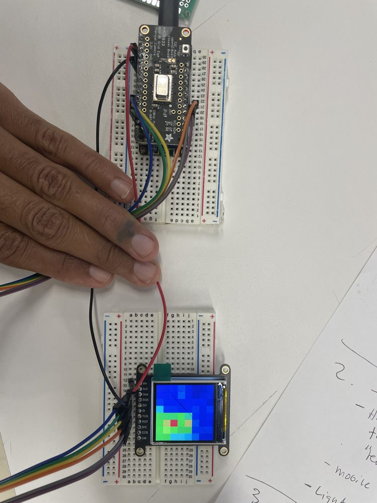
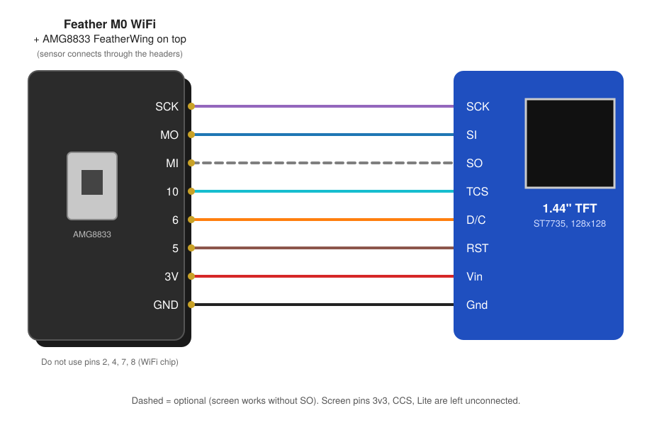
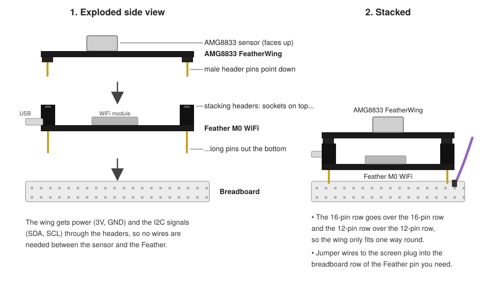
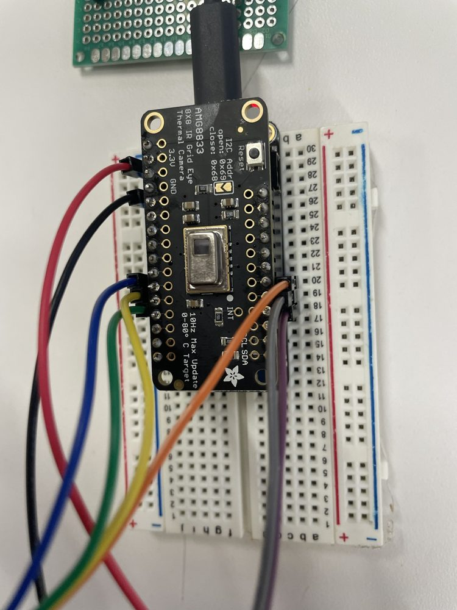
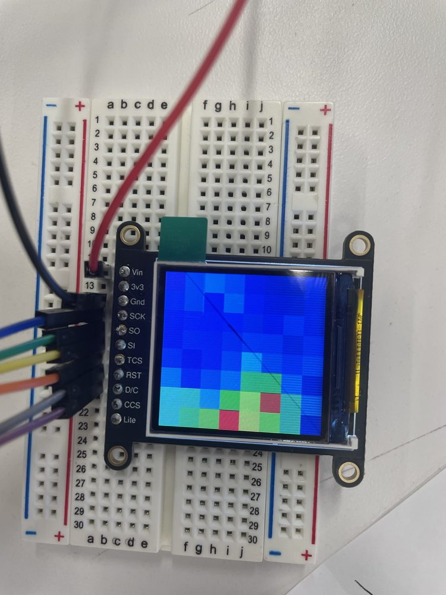

# Feather M0 WiFi Thermal Camera

A 64-pixel thermal camera made from an AMG8833 8x8 infrared sensor and a 1.44" color TFT screen, running on an Adafruit Feather M0 WiFi. The sensor is a FeatherWing that plugs directly on top of the Feather, so the only wires you need are the ones going to the screen. Warm things show up red and cool things blue, and the colors auto-scale to whatever the sensor is looking at.

This is adapted from Adafruit's AMG88xx thermal camera example, which was written for an Arduino Uno. Every change in the code is marked with a `MODIFIED` comment.

> **Note:** This README and the code changes were generated with AI assistance. See [Credits](#credits).



## Parts list

| Photo | Qty | Part | Link |
|---|---|---|---|
|  | 1 | Adafruit Feather M0 WiFi (ATSAMD21 + ATWINC1500) | [adafruit.com/product/3010](https://www.adafruit.com/product/3010) |
|  | 1 | Adafruit AMG8833 IR Thermal Camera FeatherWing | [adafruit.com/product/3622](https://www.adafruit.com/product/3622) |
|  | 1 | Adafruit 1.44" Color TFT LCD (128x128, ST7735R) | [adafruit.com/product/2088](https://www.adafruit.com/product/2088) |
|  | 1 set | Stacking Headers for Feather (12-pin + 16-pin), so the wing sits on top of the Feather | [adafruit.com/product/2830](https://www.adafruit.com/product/2830) |
|  | 2 | Half-size breadboards (one for the Feather, one for the screen) | [adafruit.com/product/64](https://www.adafruit.com/product/64) |
| | 1 pack | Jumper wires (6"), 8 needed | [adafruit.com/product/1957](https://www.adafruit.com/product/1957) |
| | 1 | Micro-USB cable (must be a **data** cable, not charge-only) | any |

Part photos are from Adafruit's product pages.

The headers need to be soldered. Unsoldered pins make an on-and-off connection that causes garbled sensor readings.

## Wiring



### Sensor: stacking the FeatherWing on the Feather

The AMG8833 FeatherWing plugs straight onto the Feather. It gets power and its I2C connection (SDA/SCL) through the headers, so it needs no wires.



1. Solder the **stacking headers** onto the Feather from the top, so the sockets sit on top of the board and the long pins come out the bottom.
2. Solder plain **male headers** onto the FeatherWing with the pins pointing down.
3. Push the Feather's long pins into the breadboard.
4. Line up the wing's 16-pin row with the Feather's 16-pin row and its 12-pin row with the 12-pin row, then press the wing into the sockets. It only fits one way round. The sensor faces up.
5. Plug the jumper wires for the screen into the breadboard, in the same row as the Feather pin you need. The breadboard row connects the wire to that pin.



### Screen

Eight jumper wires go from the Feather's pins to the screen:

| Feather M0 | 1.44" TFT screen |
|---|---|
| SCK | SCK |
| MO | SI |
| MI | SO (optional) |
| 10 | TCS |
| 6 | D/C |
| 5 | RST |
| 3V | Vin |
| GND | Gnd |

On the screen, leave **3v3, CCS and Lite** unconnected.



### Differences from the Uno wiring

- **The sensor is a FeatherWing**, so it needs no SDA, SCL, power or ground wires.
- **SPI uses the pins labeled SCK, MO and MI.** On the Uno these were pins 13, 11 and 12. On the Feather they're separate pins.
- **D/C moved from pin 8 to pin 6.** Pin 8 isn't on the Feather's header.
- **RST moved from pin 9 to pin 5.** Pin 9 is connected to the Feather's battery-voltage divider.
- **The screen runs on 3V** instead of 5V.
- **Pins 2, 4, 7 and 8 belong to the WiFi chip.** Don't connect anything to them.

### The WiFi chip and pin 8

The WiFi chip shares the SPI wires with the screen. It listens whenever its chip-select line (pin 8) is LOW, and then it scrambles the screen's data. Every sketch here sets pin 8 HIGH at the start of `setup()` to keep it quiet. If you write your own sketch for this board, do the same:

```cpp
pinMode(8, OUTPUT);
digitalWrite(8, HIGH);
```

## Software setup

### 1. Add the Feather board to the Arduino IDE

The Feather's chip (a SAMD21) is different from the Uno's, so the IDE needs Adafruit's board package to compile for it.

1. Go to **File → Preferences**. In "Additional boards manager URLs", paste:
   `https://adafruit.github.io/arduino-board-index/package_adafruit_index.json`
2. In **Tools → Board → Boards Manager**, install **Arduino SAMD Boards (32-bit ARM Cortex-M0+)**.
3. In the same window, install **Adafruit SAMD Boards**.
4. Select **Tools → Board → Adafruit Feather M0**. The WiFi version uses this same entry.

### 2. Install the libraries

In **Tools → Manage Libraries**, install the libraries below. When it asks whether to install dependencies, click **Install All**. That adds **Adafruit BusIO**, which the others need.

| Library | What it does |
|---|---|
| Adafruit GFX Library | Draws shapes and text |
| Adafruit ST7735 and ST7789 Library | Driver for the screen |
| Adafruit AMG88xx Library | Reads temperatures from the sensor |

## Sketches

Run them in this order. The two tests help you find wiring problems before you run the full camera.

| Folder | What it does |
|---|---|
| `screen_test_featherM0wifi` | Shows red, green, blue and white screens, then a border and "HELLO!". It also scans I2C for the sensor and reports results in the Serial Monitor (115200 baud). |
| `sensor_test_featherM0wifi` | Prints the raw 8x8 temperature grid to the Serial Monitor every second and shows the min, max and average on the screen. Hold your hand in front of the sensor and the MAX value should rise. |
| `thermal_cam_featherM0` | The thermal camera itself. |

### Camera settings

These are at the top of `thermal_cam_featherM0.ino`:

| Setting | Default | What it does |
|---|---|---|
| `AUTO_SCALE` | `1` | `1` stretches the colors each frame so the coldest pixel is blue and the hottest is red. `0` uses fixed `MINTEMP`/`MAXTEMP` instead. |
| `MIN_SPAN` | `3.0` | The smallest temperature spread (°C) that auto-scale will use. Lower values give more contrast but more flicker. |
| `MINTEMP` / `MAXTEMP` | `22` / `34` | Fixed color range in °C, used only when `AUTO_SCALE` is `0`. For an average room, try 18 / 30. |

With auto-scale on, the same color doesn't always mean the same temperature. It always shows what's warmest and coolest in view right now.

## Troubleshooting

| Symptom | Likely cause |
|---|---|
| Screen dark, no backlight | No power. Check Vin → 3V and Gnd → GND. |
| Backlight on, screen stays white | Data isn't reaching the screen. Check SCK, SI → MO, TCS → 10, D/C → 6, RST → 5, and make sure pin 8 is set HIGH in the code. |
| Colors offset or a noisy strip along one edge | Change `INITR_144GREENTAB` to `INITR_BLACKTAB`. |
| Screen stays black in the camera sketch but the screen test works | The sensor wasn't found, so the sketch stopped. Run the sensor test. |
| Sensor test shows readings like -331 or 438, or the board temperature reads 0.0 | The sensor's data is getting garbled. Check that the FeatherWing is pushed fully onto the Feather and that every header pin is soldered. |
| Sensor found at 0x68 instead of 0x69 | The address jumper on the wing is closed. Change `amg.begin()` to `amg.begin(0x68)` in the camera sketch. |
| Picture is mostly blue | Turn on `AUTO_SCALE`, or lower `MINTEMP`/`MAXTEMP`. |
| Board doesn't show up as a port | Use a USB data cable, or double-tap the Feather's reset button to enter the bootloader. |

## Credits

Based on the AMG88xx thermal camera example by Dean Miller for Adafruit Industries (BSD license). The original license header is kept in the camera sketch.

This README, the wiring and stacking diagrams, the code changes for the Feather M0 WiFi, and the two test sketches were generated with AI assistance (Claude by Anthropic). The build was then wired and tested on real hardware, as the photos show.

Learn more: [Adafruit Feather M0 WiFi guide](https://learn.adafruit.com/adafruit-feather-m0-wifi-atwinc1500)
